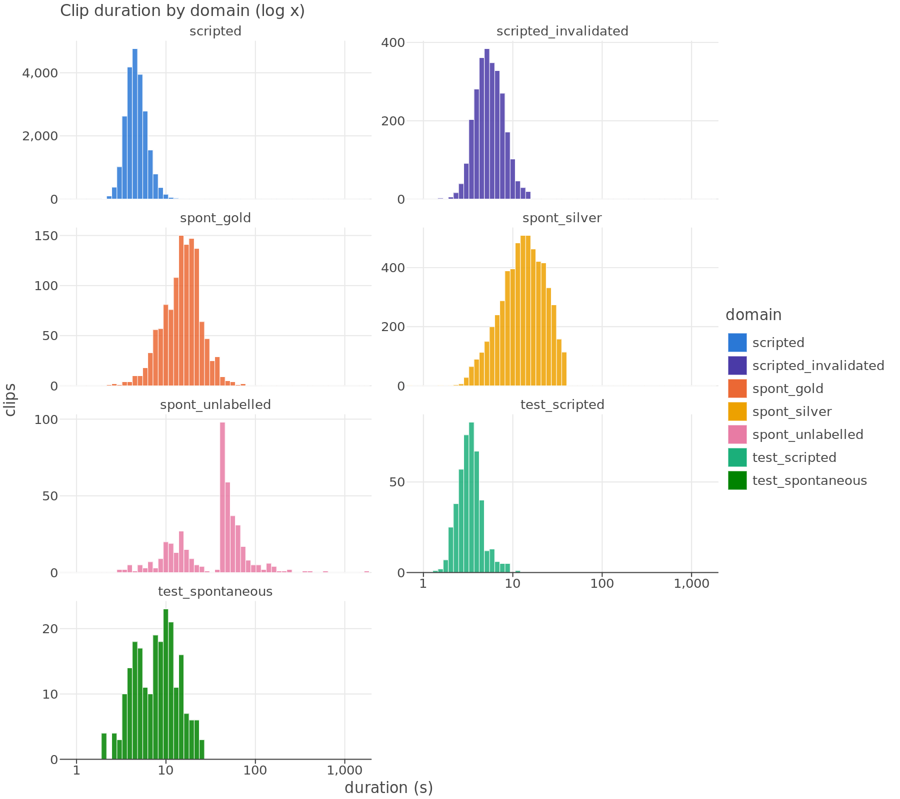
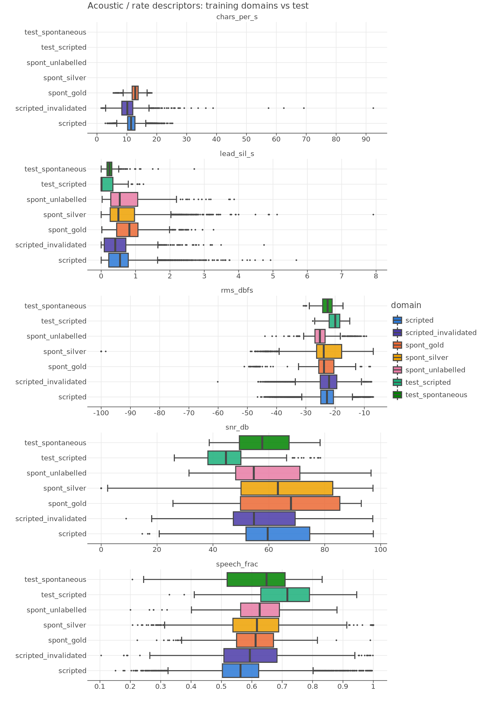
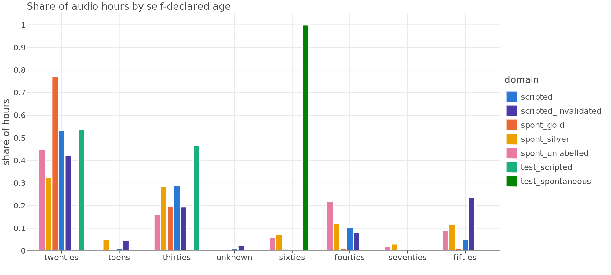
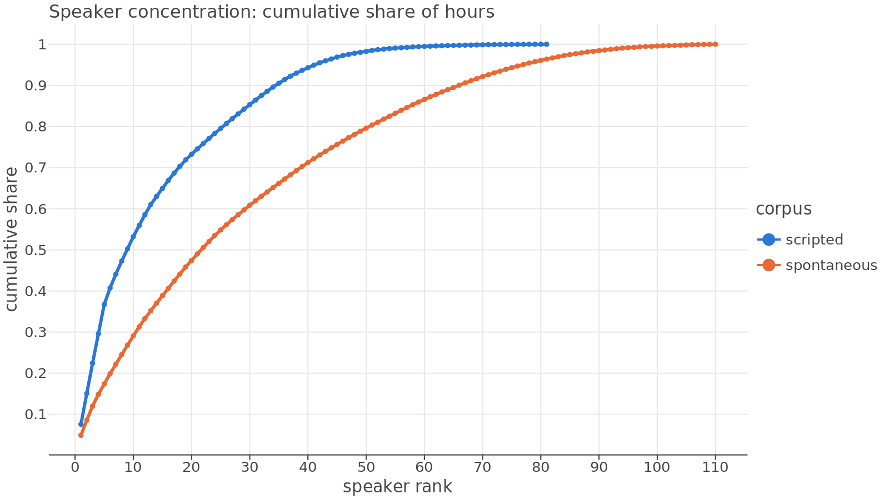
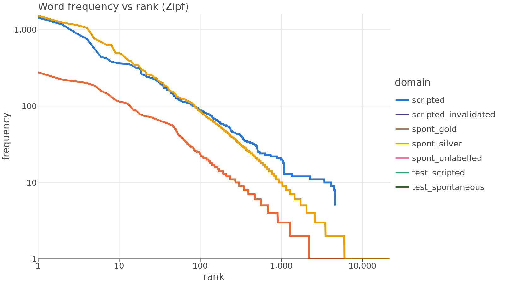

# EDA — Puno Quechua (qxp) corpora and Task 1 test set

## 1. Inventory

| domain | clips | hours | speakers | mean_dur_s | p95_dur_s | max_dur_s |
|---|---|---|---|---|---|---|
| scripted | 22727 | 30.49 | 77 | 4.83 | 7.42 | 14.9 |
| scripted_invalidated | 2696 | 4.39 | 70 | 5.87 | 10.01 | 15.6 |
| spont_gold | 1222 | 5.81 | 67 | 17.11 | 32.72 | 74.2 |
| spont_silver | 5651 | 23.59 | 99 | 15.03 | 30.67 | 40.0 |
| spont_unlabelled | 432 | 6.01 | 41 | 50.05 | 109.73 | 1715.6 |
| test_scripted | 438 | 0.43 | 1 | 3.53 | 5.7 | 11.8 |
| test_spontaneous | 221 | 0.56 | 1 | 9.1 | 19.83 | 25.8 |

## 2. Acoustic conditions (medians)

| domain | median_snr_db | median_rms_dbfs | median_speech_frac | median_lead_sil_s | median_trail_sil_s | frac_clipped | median_chars_per_s |
|---|---|---|---|---|---|---|---|
| scripted | 59.568 | -22.794 | 0.563 | 0.55 | 0.74 | 0.0068 | 11.43 |
| scripted_invalidated | 54.661 | -22.059 | 0.593 | 0.41 | 0.61 | 0.0078 | 10.17 |
| spont_gold | 67.919 | -23.796 | 0.613 | 0.82 | 0.69 | 0.0016 | 12.81 |
| spont_silver | 63.225 | -23.876 | 0.617 | 0.5 | 0.46 | 0.0204 | None |
| spont_unlabelled | 54.613 | -25.198 | 0.626 | 0.54 | 0.15 | 0.0023 | None |
| test_scripted | 44.663 | -19.954 | 0.717 | 0.01 | 0.25 | 0.0 | None |
| test_spontaneous | 57.629 | -22.551 | 0.648 | 0.24 | 0.52 | 0.0 | None |

## 3. Demographics (hours)

| domain | female_feminine | unknown | male_masculine |
|---|---|---|---|
| scripted | 21.93 | 8.12 | 0.44 |
| scripted_invalidated | 2.82 | 1.45 | 0.12 |
| spont_gold | 3.35 | 0.12 | 2.34 |
| spont_silver | 16.49 | 7.1 | 0.0 |
| spont_unlabelled | 4.33 | 1.68 | 0.0 |
| test_scripted | 0.29 | 0.0 | 0.14 |
| test_spontaneous | 0.42 | 0.0 | 0.14 |

| domain | twenties | teens | thirties | unknown | sixties | fourties | seventies | fifties |
|---|---|---|---|---|---|---|---|---|
| scripted | 16.19 | 0.26 | 8.81 | 0.35 | 0.21 | 3.19 | 0.0 | 1.47 |
| scripted_invalidated | 1.84 | 0.19 | 0.85 | 0.1 | 0.01 | 0.36 | 0.0 | 1.04 |
| spont_gold | 4.49 | 0.02 | 1.15 | 0.0 | 0.05 | 0.05 | 0.01 | 0.05 |
| spont_silver | 7.67 | 1.19 | 6.73 | 0.0 | 1.69 | 2.82 | 0.7 | 2.8 |
| spont_unlabelled | 2.69 | 0.02 | 0.98 | 0.0 | 0.34 | 1.31 | 0.12 | 0.54 |
| test_scripted | 0.23 | 0.0 | 0.2 | 0.0 | 0.0 | 0.0 | 0.0 | 0.0 |
| test_spontaneous | 0.0 | 0.0 | 0.0 | 0.0 | 0.56 | 0.0 | 0.0 | 0.0 |

## 4. Speaker concentration

| corpus | top5_share | total | n_speakers |
|---|---|---|---|
| scripted | 0.367 | 34.88 | 81 |
| spontaneous | 0.174 | 35.41 | 110 |

## 5. Split hygiene

| split_scheme | corpus | eval_split | eval_speakers | speakers_also_in_train | eval_clips | frac_text_seen_in_train |
|---|---|---|---|---|---|---|
| org_split | scripted | dev | 21 | 0 | 948 | 1.0 |
| org_split | scripted | test | 21 | 0 | 909 | 1.0 |
| org_split | spontaneous | dev | 24 | 0 | 575 | 1.0 |
| org_split | spontaneous | test | 22 | 0 | 546 | None |
| cv_split | scripted | dev | 11 | 0 | 679 | 0.007 |
| cv_split | scripted | test | 37 | 0 | 679 | 0.004 |
| cv_split | spontaneous | dev | 4 | 0 | 300 | 0.003 |
| cv_split | spontaneous | test | 6 | 0 | 296 | 0.03 |

## 6. Text

Character inventory (all labelled targets): `a`:225911 `n`:82004 `u`:80083 `i`:74651 `q`:57618 `h`:54069 `k`:48715 `y`:45347 `t`:39820 `p`:37954 `s`:36309 `m`:33320 `c`:31870 `l`:30357 `r`:27157 `w`:22468 `'`:12112 `ñ`:5932 `e`:747 `o`:648 `d`:564 `j`:302 `g`:294 `v`:246 `b`:177 `f`:91 `z`:16 `x`:1

| domain | tokens | types | hapax_frac_types | type_token_ratio | mean_word_len |
|---|---|---|---|---|---|
| scripted | 90600 | 4594 | 0.0 | 0.051 | 7.72 |
| spont_gold | 20551 | 7505 | 0.709 | 0.365 | 7.84 |
| spont_silver | 77737 | 20850 | 0.713 | 0.268 | 7.52 |

- Spontaneous-gold token OOV rate vs **scripted** vocabulary: **49.4%**
- Spontaneous-gold token OOV rate vs **spont_silver** vocabulary: **23.9%**
- Spontaneous-gold token OOV rate vs **scripted+silver** vocabulary: **22.5%**

- Scripted: 2051 distinct target sentences; clips per sentence median 12, max 27; speakers per sentence median 12.

## 7. Speaking rate (chars per voiced second)

| domain | q01 | median | q99 | n_suspicious |
|---|---|---|---|---|
| scripted | 6.88 | 11.43 | 17.88 | 2 |
| scripted_invalidated | 3.36 | 10.17 | 20.64 | 29 |
| spont_gold | 7.03 | 12.81 | 17.02 | 0 |

## Figures

